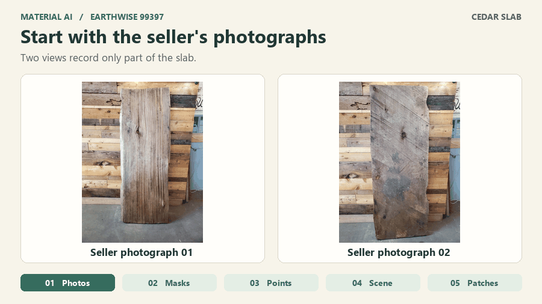
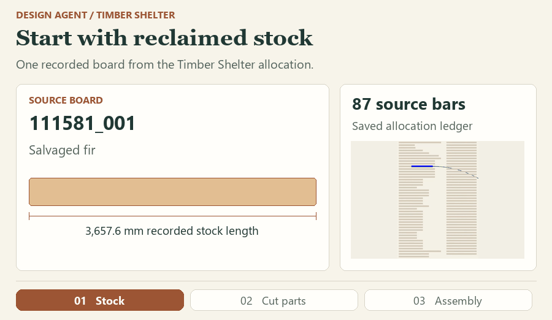
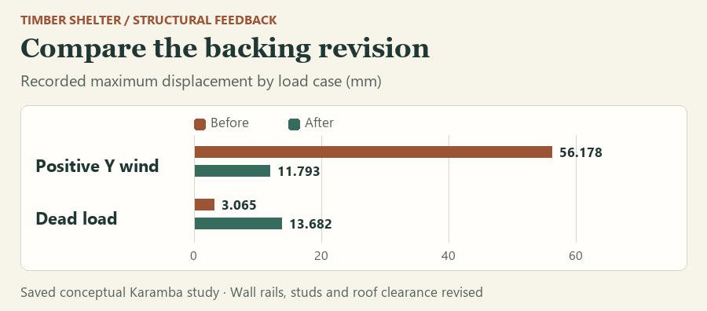

# Second Grain

## 1. Project overview

Second Grain asks how a building can take shape around the reclaimed timber already available. It pairs a study of what seller photographs can reveal about timber with a study of how finite stock can shape a span, a surface, or an assembly.


### Quick Start

[Inspect material evidence](#material-ai) · [Follow stock into a building](#design-agent) · [Browse the three cases](#2-cases-and-evidence) · [Run the offline example](#6-reproduction)

[Open the project website](https://yixumochi.github.io/second-grain-timber/showcase/) · [Find the code and data](#5-repository-layout)

<a id="2-published-record"></a>

## 2. Cases and evidence

**Quick Start.** Open a case illustration to see the saved model and the choices the timber inventory shaped.

| [Timber Shelter](https://yixumochi.github.io/second-grain-timber/showcase/#case1) | [Contour Bench](https://yixumochi.github.io/second-grain-timber/showcase/#case2) | [Open Pavilion](https://yixumochi.github.io/second-grain-timber/showcase/#case3) |
| :---: | :---: | :---: |
| <a href="https://yixumochi.github.io/second-grain-timber/showcase/#case1"></a> | <a href="https://yixumochi.github.io/second-grain-timber/showcase/#case2"></a> | <a href="https://yixumochi.github.io/second-grain-timber/showcase/#case3"></a> |
| Supply framing and enclosure from one stock pool. | Make a curve from straight timber strips. | Set frame spans from the available lengths. |

## 3. Research outputs

<a id="photograph-screening"></a>

### Material AI

Use seller photographs to identify visible surfaces, mark gaps in the evidence, and decide what needs a closer look before assigning a piece to a part.

[](https://yixumochi.github.io/second-grain-timber/showcase/#material-workflow)

The cedar slab study shows which surfaces the photographs support. Formal grade remains unknown.

**Quick Start.** Open the material workflow and step through the saved cedar slab study. To screen the three specimens bundled with this repository, use the CUDA setup and run `bash run_test.sh`. [Material workflow](https://yixumochi.github.io/second-grain-timber/showcase/#material-workflow) · [Screening instructions](docs/reproduction.md#screen-three-specimens)

<a id="offline-allocation"></a>

### Design Agent

Use the brief and stock limits to set the design constraints, assign cuts to available pieces, and review the resulting assembly.

[](https://yixumochi.github.io/second-grain-timber/showcase/#film-stock-allocation)

[](https://yixumochi.github.io/second-grain-timber/showcase/#ai-structural-change)

The shelter revision reduced displacement under the recorded positive Y wind case and increased it under dead load. [Saved structural study](https://yixumochi.github.io/second-grain-timber/showcase/#ai-structural-change)

**Quick Start.** Watch the stock allocation, then run `python baseline/run.py` to replay one saved shelter revision. [Allocation film](https://yixumochi.github.io/second-grain-timber/showcase/#film-stock-allocation) · [Run the replay](#6-reproduction)

For the stock length change experiment and the separately saved Karamba comparisons, see the [baseline notes](baseline/README.md).

## 4. Reading order

Start with a case, follow the evidence behind its design decisions, then pick a local example to run. [Cases](#2-cases-and-evidence) · [Reproduction](#6-reproduction)

## 5. Repository layout

| Where | What it contains |
| --- | --- |
| [`baseline/`](baseline/README.md) | Allocation replay, saved inputs, and verification reports |
| [`src/`](src/), [`scripts/`](scripts/) | Photograph screening code and runners |
| [`vendor/`](vendor/), [`configs/`](configs/) | Pinned model sources and checkpoint checksums |
| [`data/all/`](data/all/), [`audit/`](audit/) | Three specimen photo sets and recorded checks |
| [`docs/`](docs/), [`licenses/`](licenses/) | Run instructions and source notices |

## 6. Reproduction

**Quick Start.** Clone the repository and replay the saved allocation with Python 3.10 or newer. It uses the Python standard library.

```sh
git clone https://github.com/yixumochi/second-grain-reproduce.git
cd second-grain-reproduce
python baseline/run.py
```

Read `baseline/results/baseline/verification.json`. The replay checks 15 added members from 10 stock sources. Engineering approval remains `UNKNOWN`.

For photograph screening, prepare the CUDA environment in Linux or WSL and download the model weights using the guide. Run `bash run_test.sh` to screen listings 117692, 120235, and 111575 and write their records under `outputs/`. The full photo archive is held separately. [Reproduction guide](docs/reproduction.md) · [Methods and sources](METHODS_AND_SOURCES.md)
